# Organization: Administration: General

The General administration module provides centralized configuration options for domains, email templates, error logs, grid schemas, list entries, metric templates, and SMTP domains[cite: 11].

* **Navigation Path:** Administration > General[cite: 11].

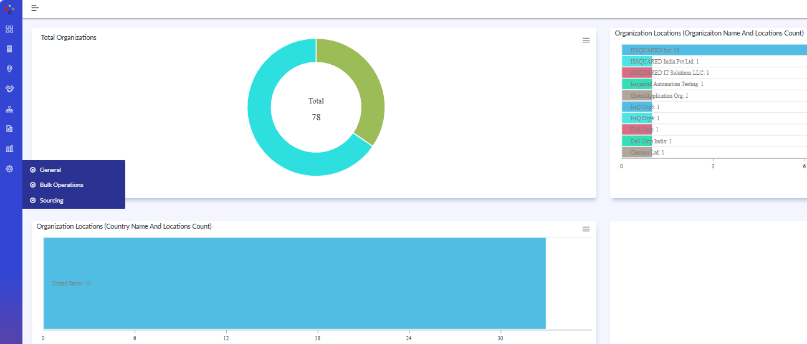{width=93%}

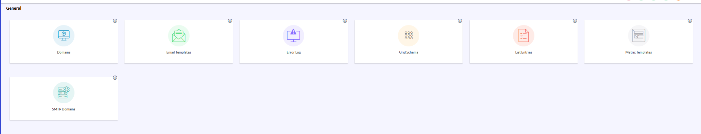{width=98%}

## Module Configurations

### Domains
* Track internet domain registrations, renewal dates, registrar accounts, credentials, and linked SMTP domains[cite: 11]. *(Note: Create SMTP domains before mapping them to domain records[cite: 11].)*
* Click **Create**, fill out domain parameters (Domain Name, Dates, Currency, Cost, Registrar info, Account #, Username/Password, Private flag, Address), and save[cite: 11].

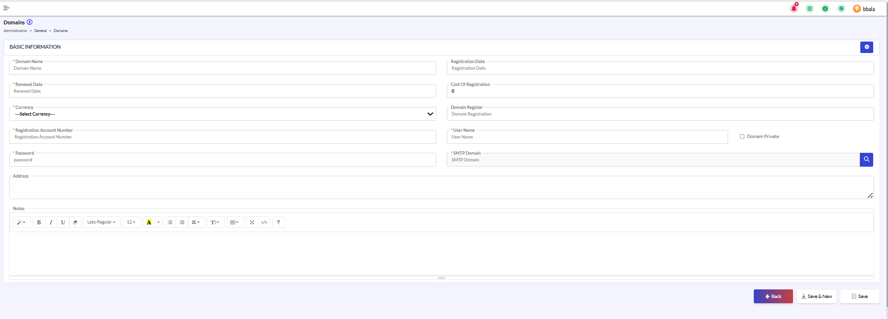{width=94%}

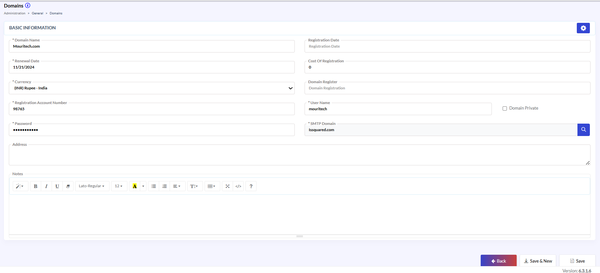{width=93%}

### Email Templates
* Navigate to **Administration > General > Email Templates** to configure email titles, subjects, types, business objects, attributes, notifications, and body contents[cite: 11].

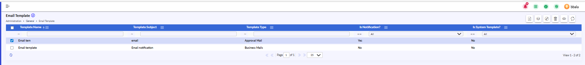{width=93%}

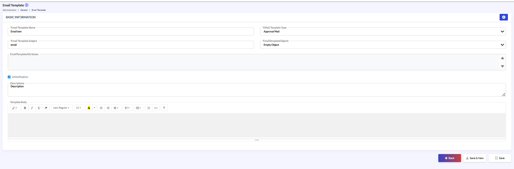{width=93%}

### Error Log
* Review automated system logs, exception info, affected modules, and users for troubleshooting[cite: 11].

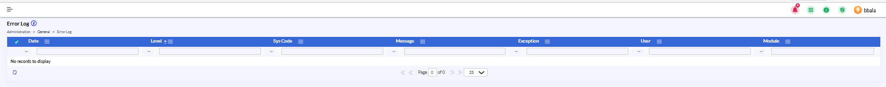{width=99%}

### Grid Schema
* Select a Grid Name from the dropdown, customize column visibility checkboxes and display order, and click **Save** (or **Restore Defaults**)[cite: 11].

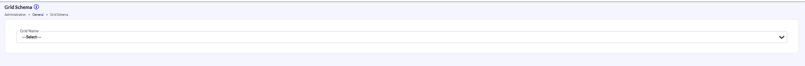{width=95%}

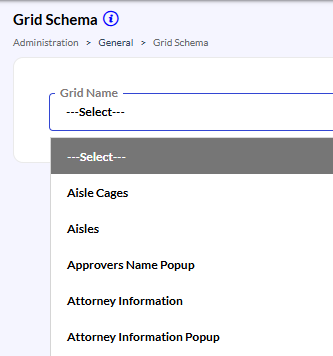{width=20%}

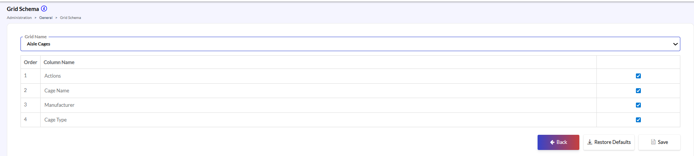{width=95%}

### List Entries
* Manage configurable lookup lists that populate dropdowns across modules[cite: 11]. Select a record, edit entry types, status, child dependencies, and notes[cite: 11].

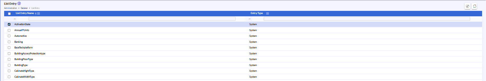{width=91%}

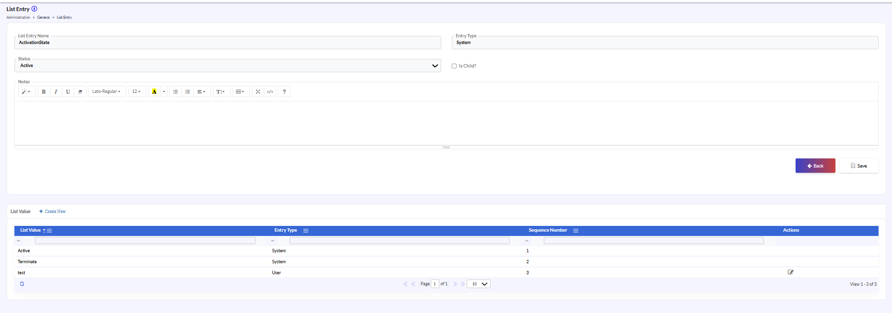{width=95%}

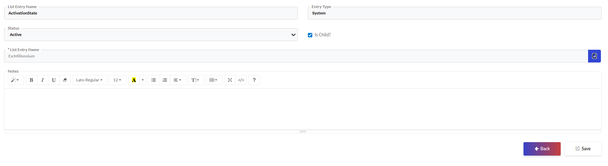{width=95%}

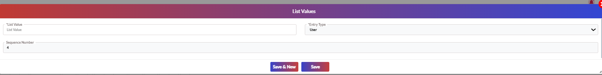{width=94%}

### Metric Templates
* Create and manage reusable scoring templates containing evaluation metrics, weights, and scoring ranges for assessments or audits[cite: 11].
* Create a template, then use the **Metric Template Values** section to add individual metrics and scoring configurations[cite: 11].

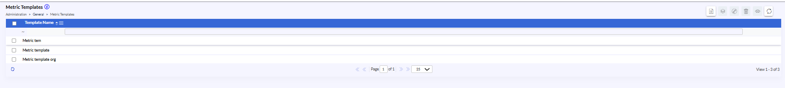{width=95%}

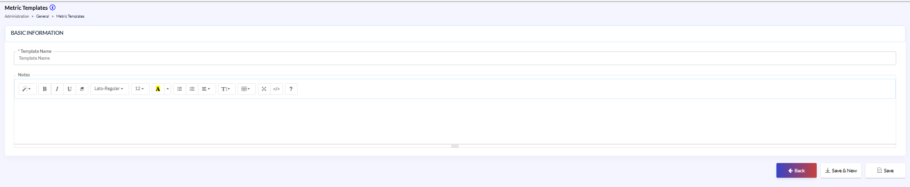{width=95%}

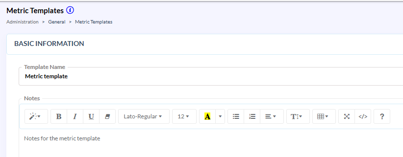{width=83%}

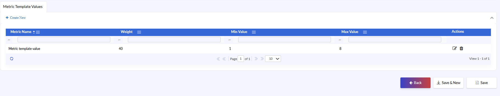{width=95%}

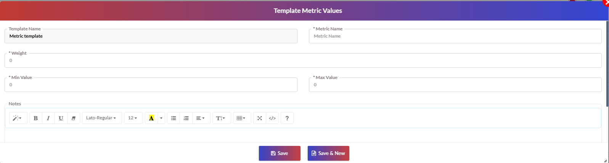{width=88%}

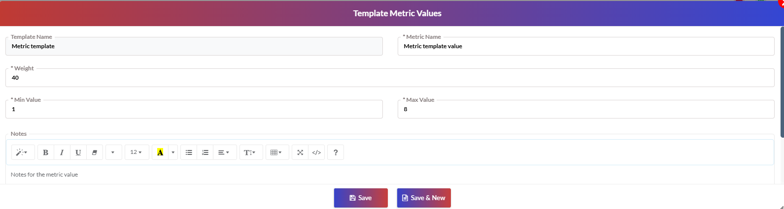{width=88%}

### SMTP Domains
* Maintain approved email domains for system communications[cite: 11]. Click **Create**, enter the SMTP Domain Name and notes, then save[cite: 11].

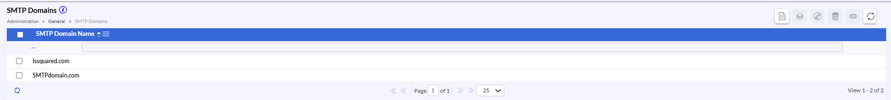{width=93%}

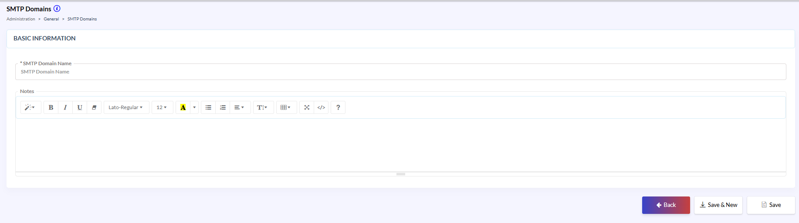{width=94%}

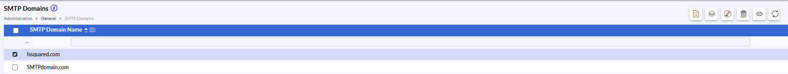{width=93%}

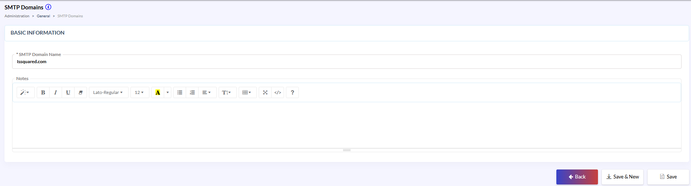{width=94%}

---

## Support

* For further queries, reach out to support at: **support@issquared.net**[cite: 11]

{width=84%}