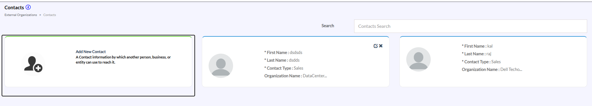
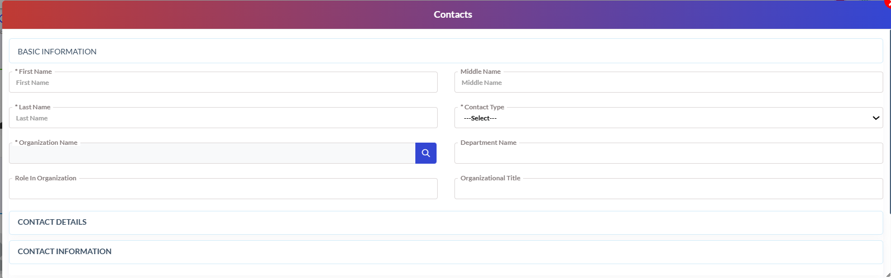
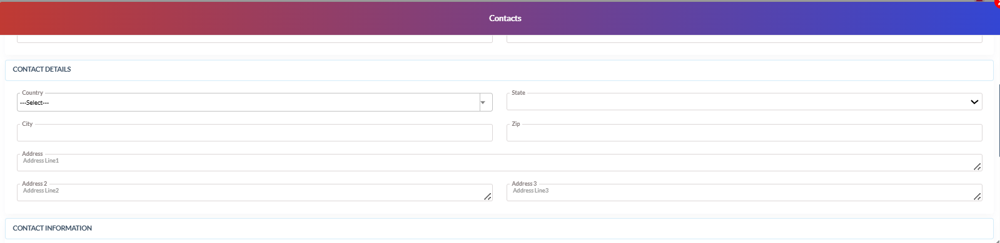
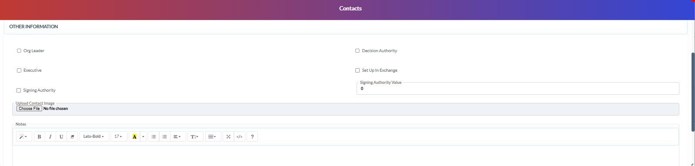

# Organization: Contacts

The Contacts section stores personal, organizational, communication, and authority-related data for contacts associated with external organizations[cite: 10].

* **Navigation Path:** External Organizations > Contacts[cite: 10].

{width=93%}

## Create / Edit Contact

* Navigate to **External Organizations > Contacts**, click **Add New Contact** or edit an existing record[cite: 10]. Populate the standard sections[cite: 10]:

### Basic Information Section
* Enter First, Middle, and Last Name, Contact Type, Organization Name, Department Name, Role in Organization, and Organizational Title[cite: 10].

{width=94%}

{width=94%}

### Contact Details Section
* Maintain address lines 1–3, Country, State, City, and Zip Code[cite: 10].

{width=96%}

### Contact Information Section
* Expand to record supplementary communication channels as per organizational standards[cite: 10].

{width=98%}

### Other Information Section
* Configure executive authority, leadership designations, signing authority, exchange details, contact images, and operational notes[cite: 10].

{width=95%}

## Common Actions Reference
Standard operations across the module include **Create**, **Edit**, **Save**, **Save & New**, **Search**, **View**, and **Refresh**[cite: 10].