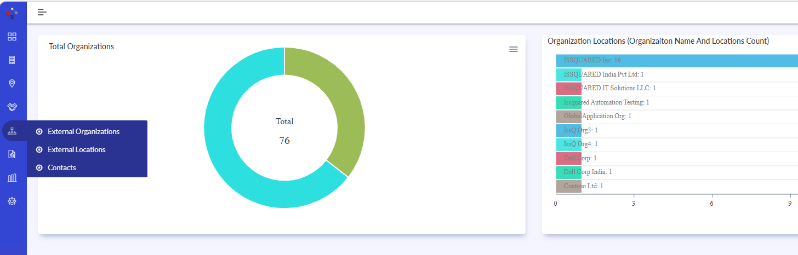
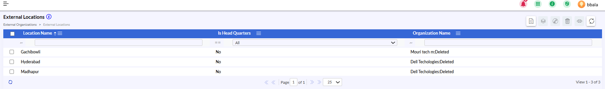
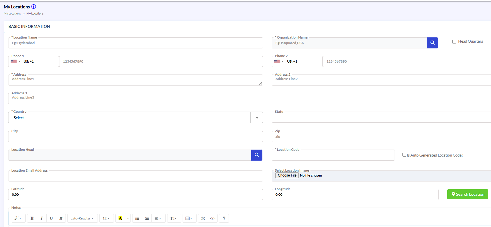
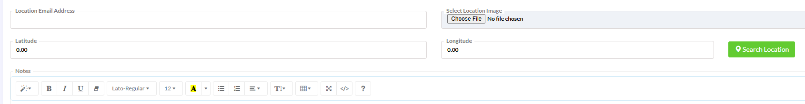
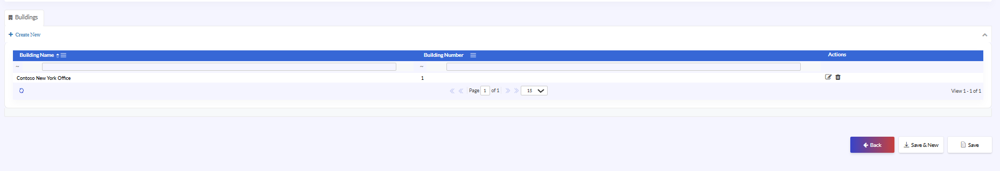
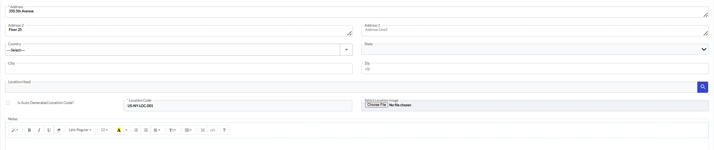

# Organization: External Locations

* Navigate to **External Organizations > External Locations** to view, filter (by Location Name, Headquarters Status, or Organization Name), view, edit, or delete external locations[cite: 13].

{width=93%}

{width=95%}

## Create / Edit External Location

This screen acts as the master record and parent configuration layer for buildings linked to external locations[cite: 13].

* **Basic Information & Location Details:** Enter Location Name, Organization Name, Phone numbers, Email, and Headquarters status[cite: 13].
  
  {width=95%}

  {width=89%}

  {width=94%}

* **Address Information:** Enter Address lines 1-3, Country, State, City, and ZIP code[cite: 13].
* **Operational Information:** Specify Location Head, Location Code generation rules, upload images, and add operational notes before clicking **Save / Update**[cite: 13].

  {width=95%}

## Manage Buildings in External Locations

The Buildings section manages physical facilities, hierarchy expansion, and infrastructure[cite: 13].

* Access the buildings grid within an external location record to create, edit, or delete building entries[cite: 13].
  
   {width=97%}

* Configure building-specific address information, operational parameters, and notes[cite: 13].

  {width=96%}