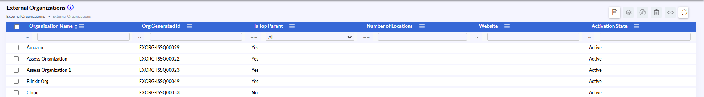
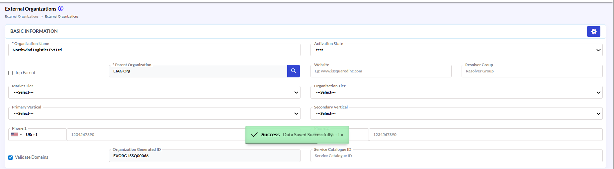
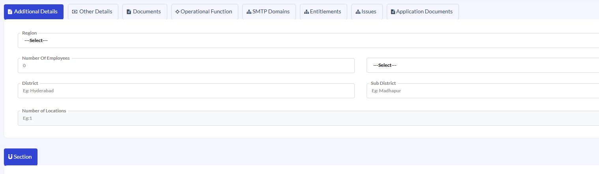
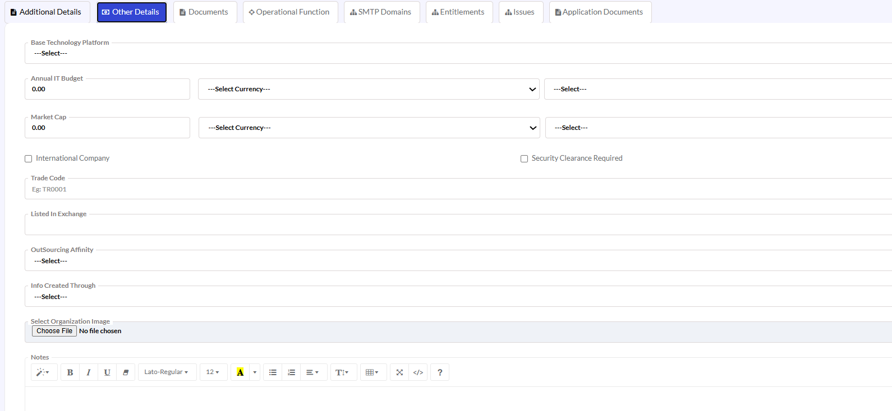
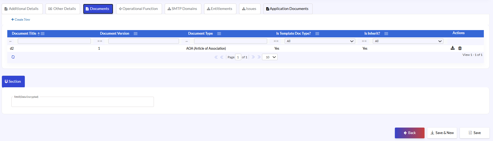
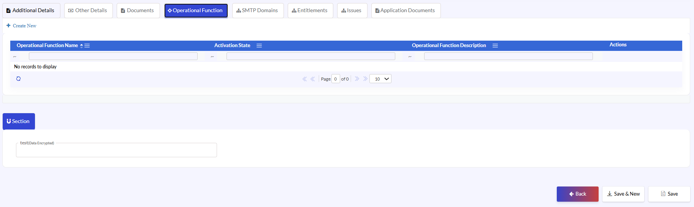
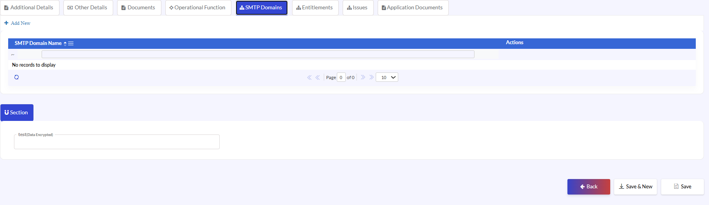
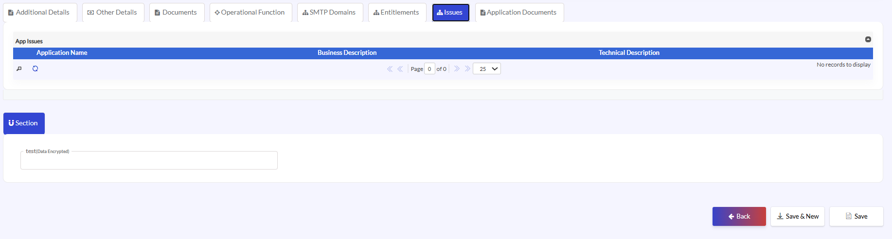
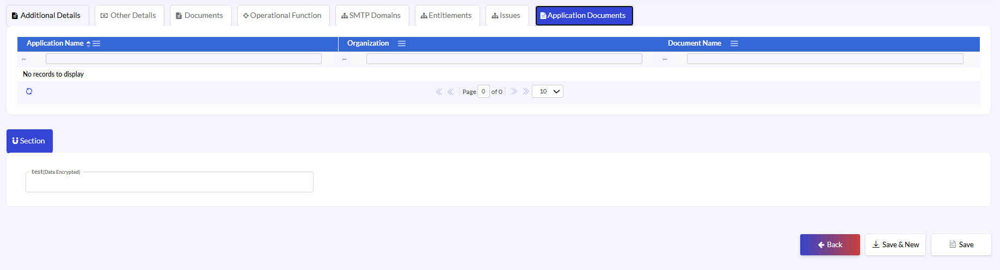

# Organization: External Organizations

The External Organizations module manages third-party vendors, partners, subsidiaries, clients, and associated business entities[cite: 12].

* Navigate to **Organization > External Organizations** to open the searchable listing grid (displaying Organization Name, ID, Top Parent Status, Locations, Website, and Activation State)[cite: 12].

{width=93%}

{width=93%}

{width=95%}

## Common Toolbar Actions
Toolbar options (**Clone**, **Delete**, **View**, and **Refresh**) follow standard application behavior[cite: 12].

{width=99%}

## Create / Edit External Organization

* Click create or select an existing organization to edit[cite: 12].
* **Basic Settings:** Enter Organization Name, Activation State, Parent Organization, Top Parent status, Website, Resolver Group, Phone numbers, Service Catalogue ID, and classifications (Market Tier, Organization Tier, Primary/Secondary Verticals)[cite: 12].
  
  {width=93%}

  {width=94%}

  {width=94%}

* **Additional Details Tab:** Specify Region, Employee count, District, Sub District, and Locations[cite: 12].
  
  {width=94%}

* **Other Details Tab:** Configure Base Technology Platform, Annual IT Budget, Market Cap, International Company flag, Security Clearance requirements, Trade Codes, stock exchanges, outsourcing affinity, images, and notes[cite: 12].
  
  {width=94%}

  {width=95%}

### Associated Sub-Tabs

* **Documents:** Upload and version control associated documentation[cite: 12].
  
  {width=95%}

  {width=95%}

* **Operational Function:** Define operational functions, activation states, and descriptions[cite: 12].
  
  {width=92%}

* **SMTP Domains:** Add and verify approved SMTP domain mappings[cite: 12].
* **Entitlements:** Maintain service entitlements[cite: 12].
* **Issues:** Track linked application problems, technical/business descriptions[cite: 12].
  
  {width=94%}

  {width=94%}

* **Application Documents:** Associate specific application-related files[cite: 12].
  
  {width=95%}