# Organization: My Locations

The My Locations module is used to create and maintain location records (offices, branches, facilities, addresses, and location hierarchies)[cite: 5].

* Navigate to **My Locations** via the main navigation menu[cite: 5].

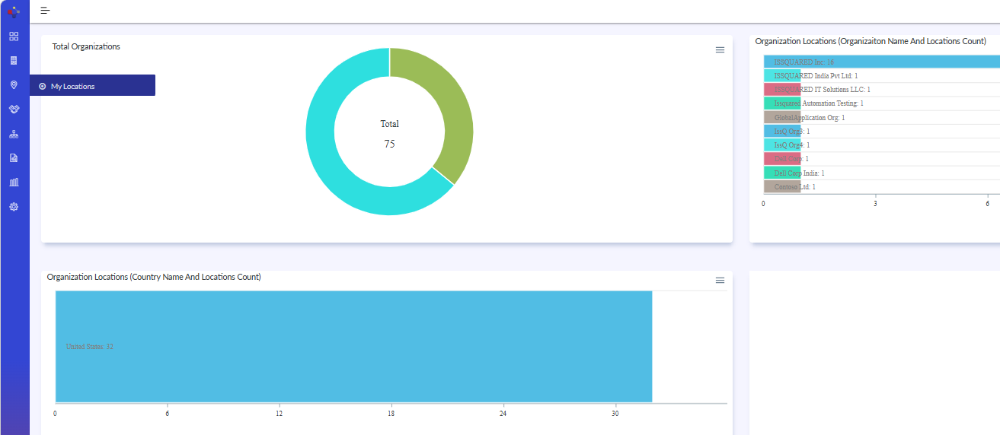{width=94%}

## Create New Location

### Basic Information Tab
* Open the My Locations screen and click create[cite: 5].
* Enter details such as Location Name, Organization Name, Phone numbers, Address lines 1-3, Country, State, City, and Zip[cite: 5].
* Assign a Location Head, enter a Location Email Address, and specify or auto-generate a Location Code[cite: 5].
* Enable **Head Quarters** if applicable, upload a location image, and enter Latitude/Longitude or use the search tool[cite: 5].
* Capture notes and click **Save** or **Save & New**[cite: 5].

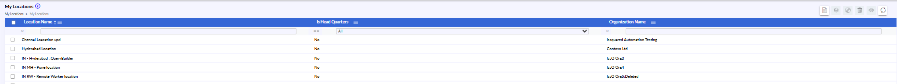{width=93%}

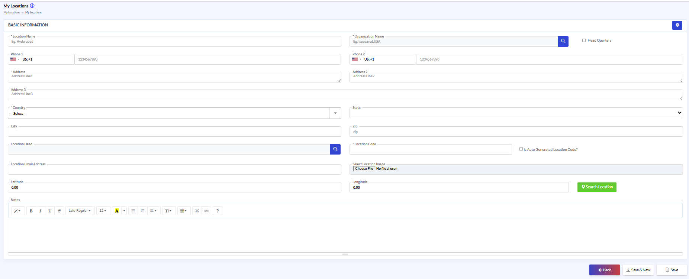{width=93%}

### Additional Information Tab
* Navigate to the **Additional Information** tab under the buildings section to maintain supplementary contact and address information[cite: 5].
* Click **Save / Update**[cite: 5].

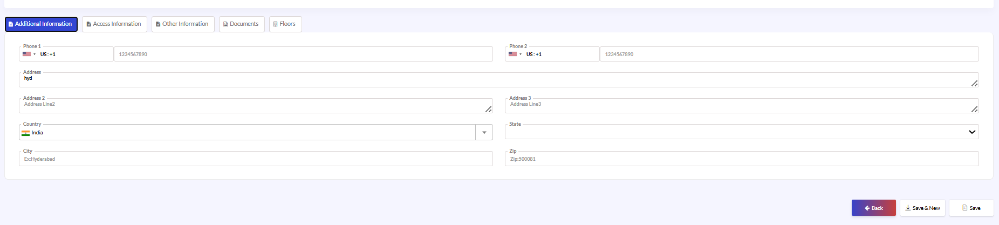{width=98%}

### Access Information Tab
* Configure building access rules and security details based on business requirements[cite: 5].
* Click **Save / Update**[cite: 5].

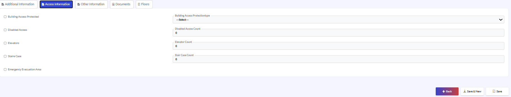{width=96%}

### Other Information Tab
* Maintain additional building-specific operational or administrative custom details[cite: 5].
* Click **Save / Update**[cite: 5].

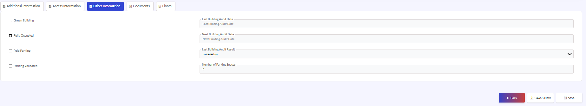{width=98%}

### Documents Tab
* Upload, replace, or manage building-related supporting documents[cite: 5].
* Click **Save / Update**[cite: 5].

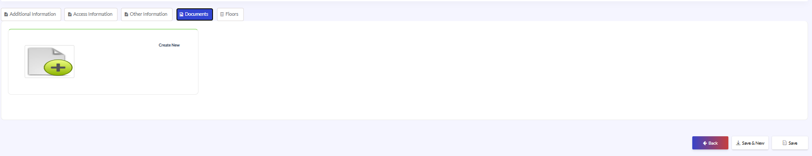{width=98%}

### Floors Tab
* Create and manage floor records associated with the building (floor identification, numbering, and operational details)[cite: 5].
* Click **Save / Update**[cite: 5].

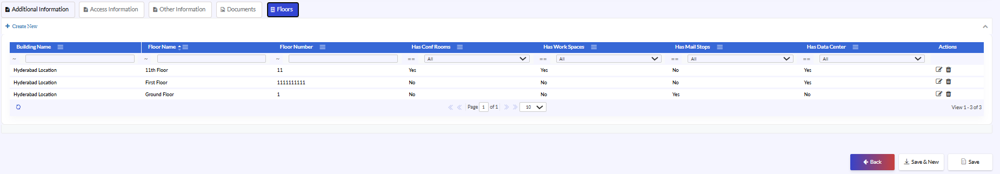{width=98%}

## Manage Location Records

### Edit Location Details
* Select a location record from the list view, open in edit mode, update necessary fields (address, contacts, geo-location, images, or notes), and click **Save / Update**[cite: 5].

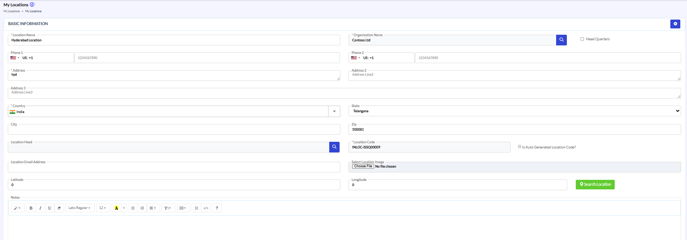{width=96%}

### Manage Buildings within Locations
* **Basic Information:** Navigate to the Buildings section under a location record, click Create New, enter Building Name, Number, and check **Is Primary** if applicable[cite: 5].
  
  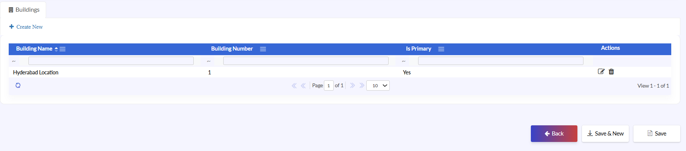{width=94%}

  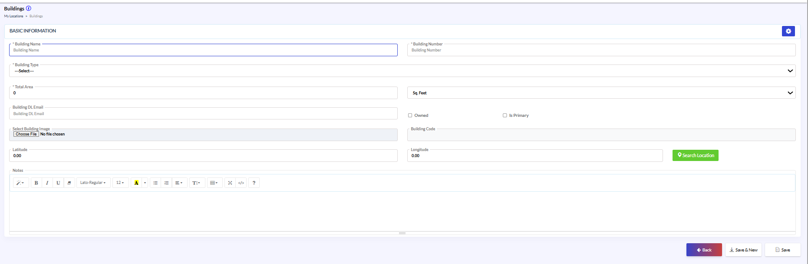{width=93%}

* **Additional Information:** Update secondary contacts, address fields, country, state, city, and zip[cite: 5].
  
  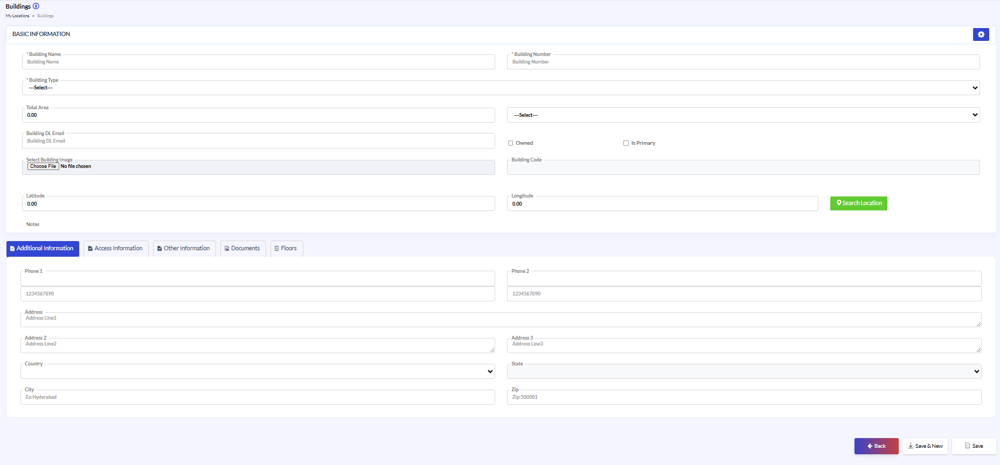{width=97%}

* **Access Information:** Configure operational access rules[cite: 5].
  
  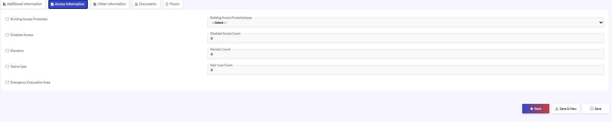{width=98%}

* **Other Information:** Update custom operational data[cite: 5].
  
  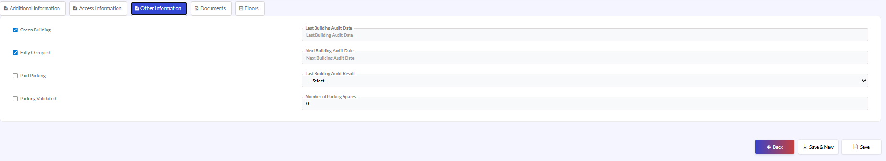{width=99%}

* **Documents:** Upload building-related attachments[cite: 5].
  
  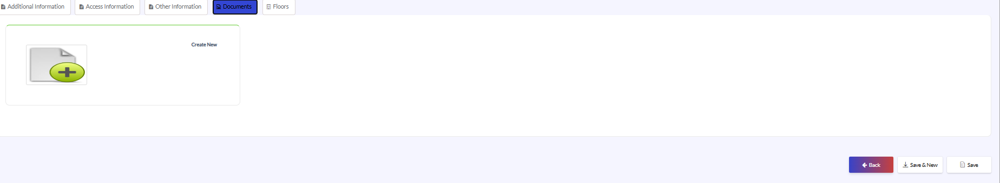{width=98%}

* **Floors:** Manage floor identification, workspace allocations, and types[cite: 5].
  
  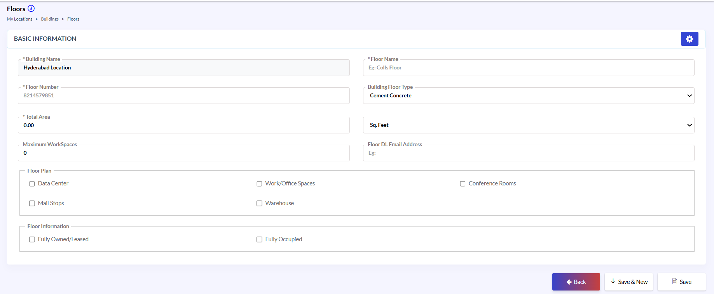{width=95%}

### Manage Floor Details and Availability
* Configure detailed floor attributes including Building/Floor Name, Number, Floor Type, Total Area, Measurement Units, Max Workspaces, and DL Email Address[cite: 5].
* Configure **Floor Plan Options** (Data Center, Work/Office Spaces, Conference Rooms, Mail Stops/Warehouse) and **Floor Information** (Fully Owned/Leased, Fully Occupied)[cite: 5].
* Click **Save**[cite: 5].

{width=95%}

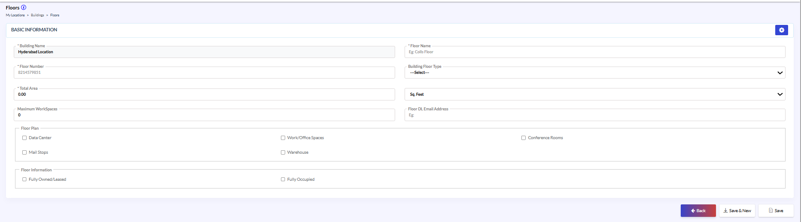{width=97%}