# Organization: My Organizations

* Navigate to **My Organizations** by opening the main navigation menu from the left panel and selecting **Organization > My Organizations**[cite: 4].
* The My Organizations screen displays a list of all configured organization records within the platform[cite: 4].

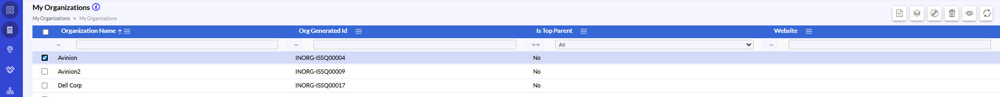{width=99%}

## Create Organization

To create a new organization, click the **Create** icon from the top toolbar[cite: 4]. Configure the tabs detailed below:

### Basic Information Tab
* Enter required details such as Organization Name, Parent Organization, Website, Resolver Group, Phone Numbers, and Number of Locations[cite: 4].
* Select **Validate Domains** if domain validation is required[cite: 4].
* Select the **Publicly Traded** checkbox if the organization is publicly listed[cite: 4].

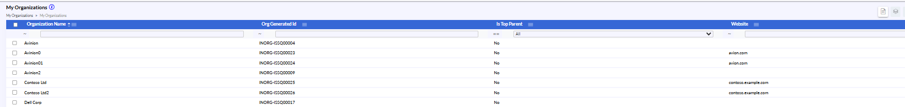{width=98%}

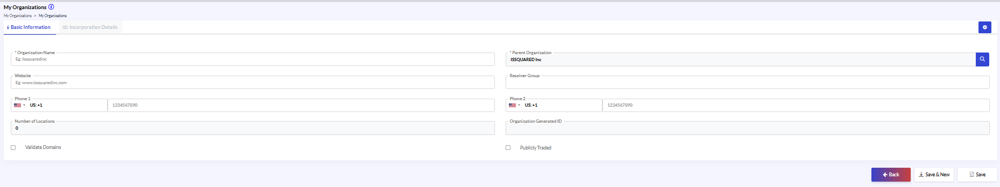{width=99%}

### Incorporation Details Tab
* Enter incorporation details such as Incorporation Name, Type, Status, Country, State, Number, Date, Fees, and Costs[cite: 4].
* Specify whether the organization is incorporated internally or through a consultancy, and enter consultancy details if applicable[cite: 4].
* Click **Save** to create the record, or **Save & New** to save and create another organization[cite: 4].

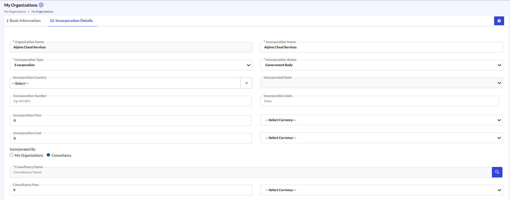{width=95%}

### License Details Tab
* Review or update License Name, Type, and Status[cite: 4].
* Use **Add New** to create additional license records[cite: 4].
* Update custom fields and organization-specific information in the Other Details section[cite: 4].

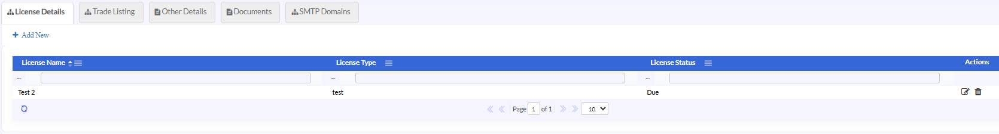{width=95%}

### Trade Listing Tab
* Update trade-related details and listing information[cite: 4].
* Click **Save / Update** to apply changes[cite: 4].

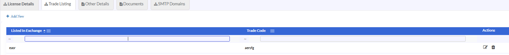{width=95%}

### Other Details Tab
* Update custom fields such as name fields, identification/roll numbers, text fields, date fields, and password confirmation fields[cite: 4].
* Click **Save / Update** to apply changes[cite: 4].

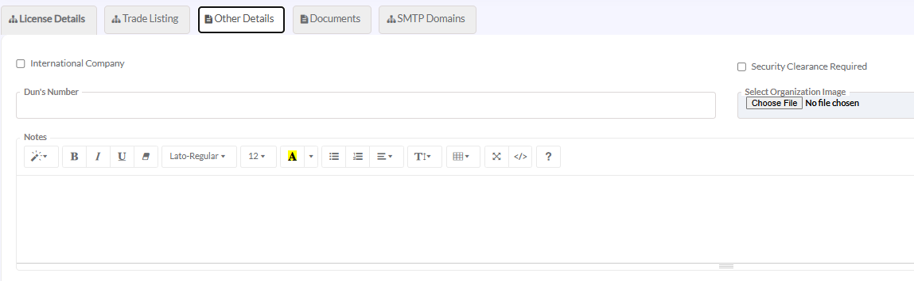{width=93%}

### Documents Tab
* Upload, replace, or manage required organization documents[cite: 4].
* Click **Save / Update** to apply changes[cite: 4].

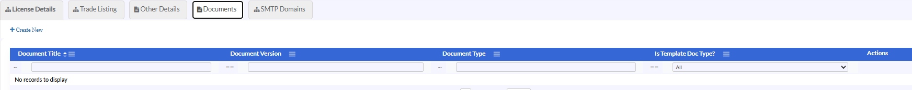{width=93%}

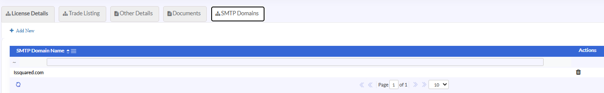{width=93%}

### SMTP Domains Tab
* Click to select or add SMTP domains from the available list[cite: 4].
* Use search filters, select the required domain checkbox, and click **OK**[cite: 4].
* Click **Save / Update** to apply changes[cite: 4].

{width=97%}

### Settings Features Tab
*(Note: Some settings features become fully functional only after the organization record is saved successfully[cite: 4].)*

* **List Values:** Manage predefined dropdown values used across organization forms[cite: 4]. Open Settings, select **List Values**, click **Add New**, and save[cite: 4].
  
  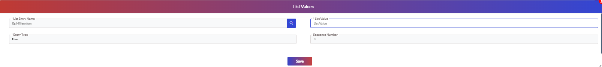{width=98%}

* **Custom Fields:** Create additional fields dynamically[cite: 4]. Open Settings, select **Custom Fields**, click **Add New**, enter Field Name, Label Name, and select the Field Type, Section, and Class before saving[cite: 4].
  
  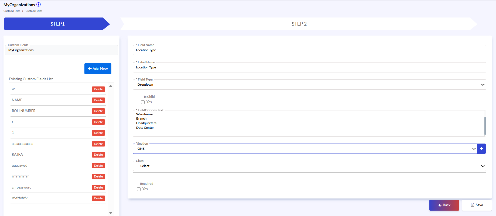{width=93%}

* **Record Level Security:** Manage organization access permissions for users and roles[cite: 4]. Open Settings, select **Record Level Security**, choose the Roles or Users tab, configure View, Edit, Delete, or Grant Access permissions, and click **Set Permissions / Save**[cite: 4].
  
  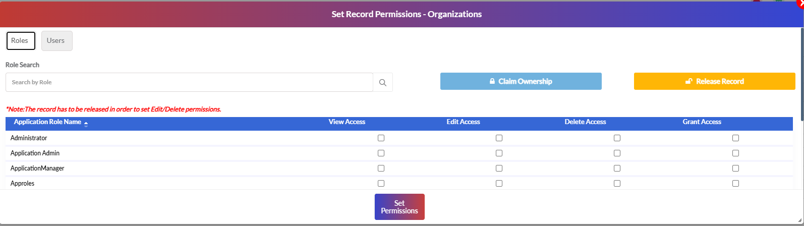{width=93%}

  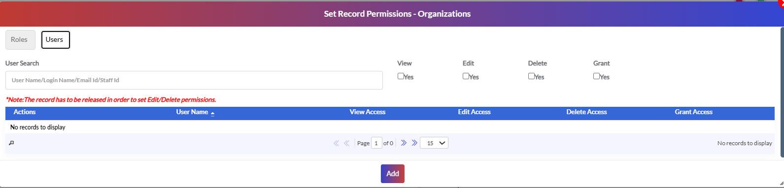{width=93%}

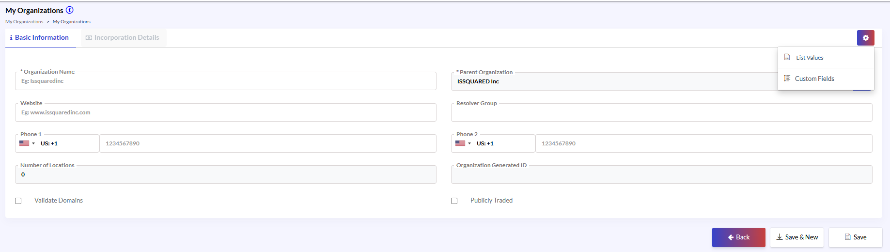{width=95%}

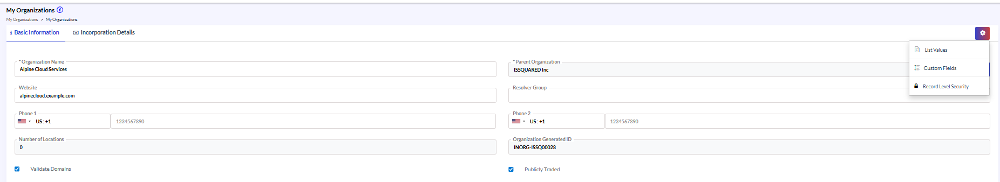{width=95%}

## Manage Organization Records

### View Organization
* Select an organization record from the list and click the **View** icon from the top toolbar to inspect details in read-only mode across tabs (Basic Information, Incorporation Details, License Details, Trade Listing, Other Details, Documents, and SMTP Domains)[cite: 4].

### Clone Organization
* Select an organization from the list, click the **Clone** icon, modify copied details as required, and click **Save / Create**[cite: 4].

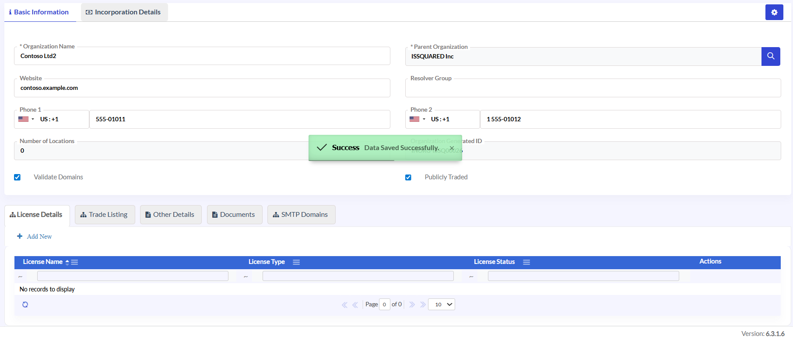{width=94%}

### Delete Organization
* Select an organization from the list, click the **Delete** icon, verify details in the confirmation message, and click **Confirm / Delete**[cite: 4].

{width=99%}

### Refresh Organization List
* Click the **Refresh** icon from the top toolbar to reload and display the latest available records[cite: 4].

{width=99%}