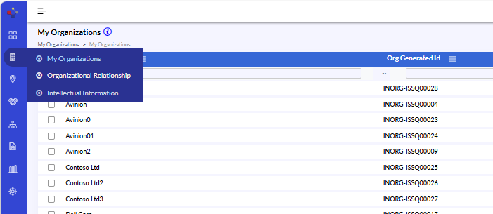
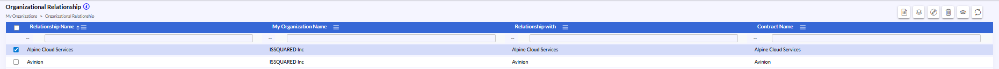

# Organization: Organizational Relationship

This section is used to create and manage relationships between organizations (such as customers, subsidiaries, vendors, partners, or service providers) to track business associations, contracts, and hierarchies[cite: 8].

{width=93%}

## Edit/Modify Relationship Details

* Navigate to **Organization > Organizational Relationship**[cite: 8].
* Select the relationship record from the list view and open it in edit mode[cite: 8].
* Update fields such as Relationship Type, Contract Information, Name, Description, or Notes[cite: 8].
* Click **Save / Update**[cite: 8].

## Common Toolbar Actions

The Organizational Relationship section supports standard toolbar actions:
* **Clone:** Creates a duplicate copy of the selected record[cite: 8].
* **Delete:** Permanently removes the relationship record[cite: 8].
* **View:** Opens the record in read-only mode[cite: 8].
* **Refresh:** Reloads the list view[cite: 8].

{width=98%}

{width=98%}